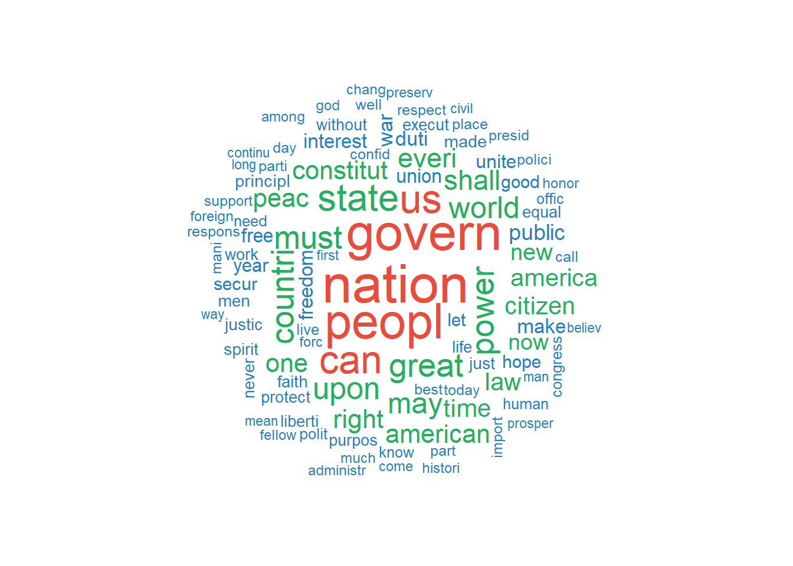
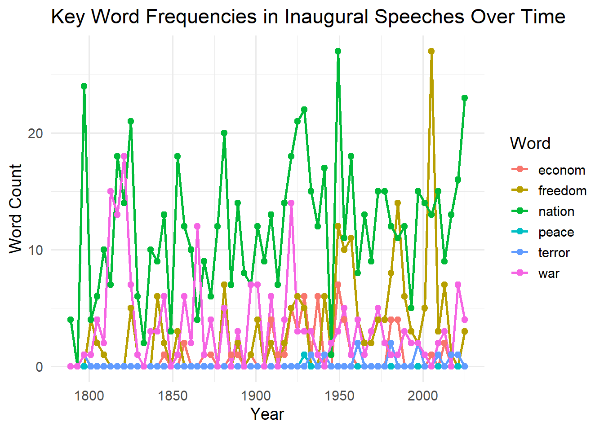
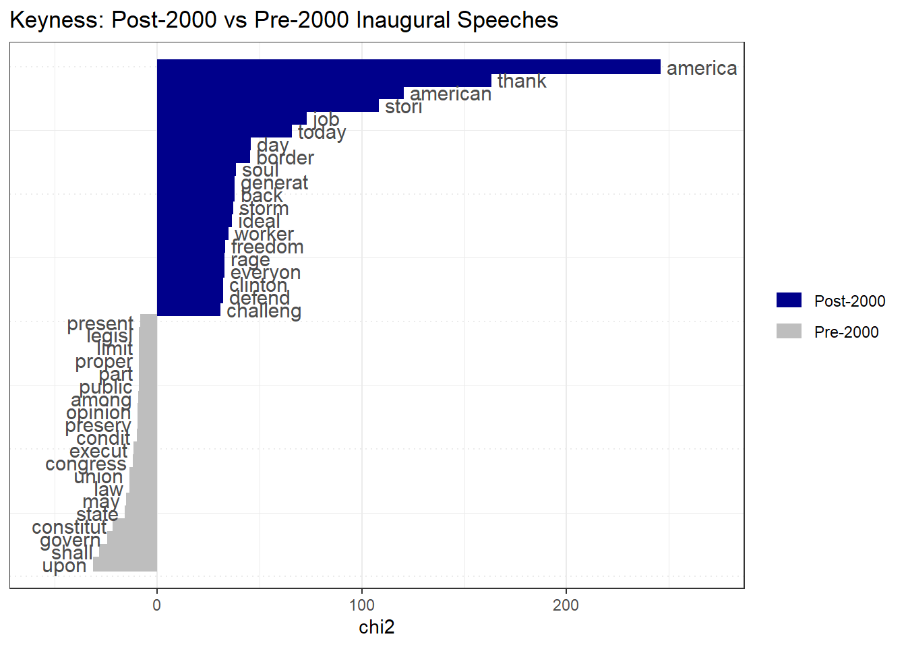
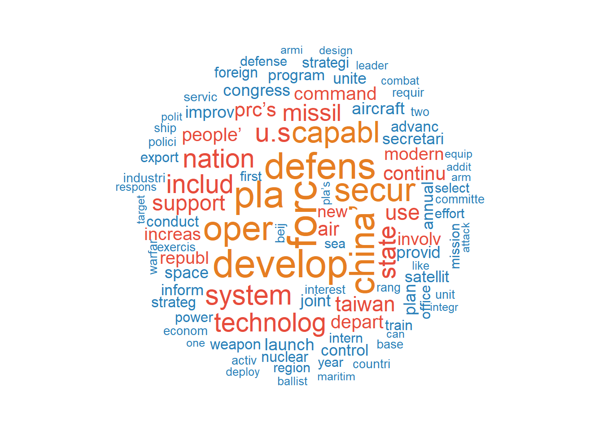
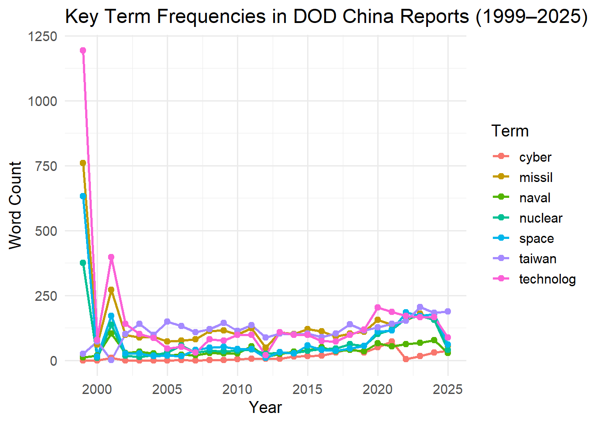
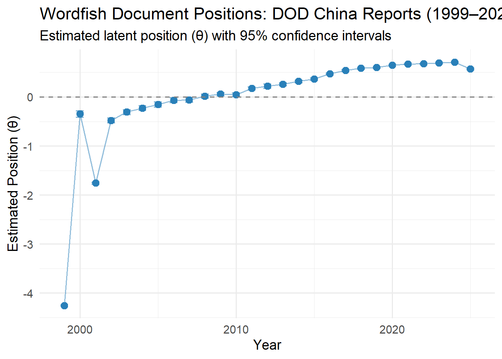
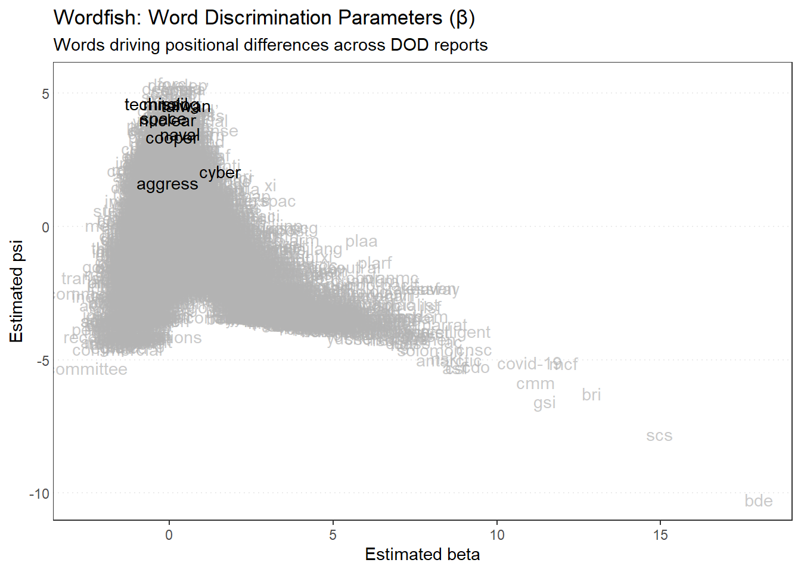
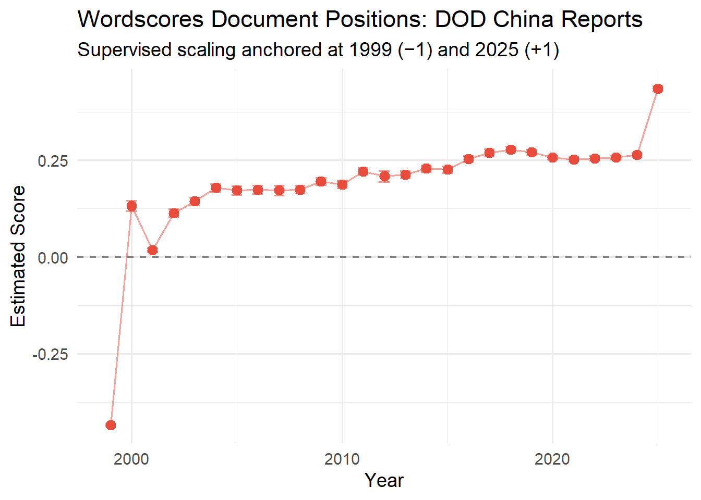
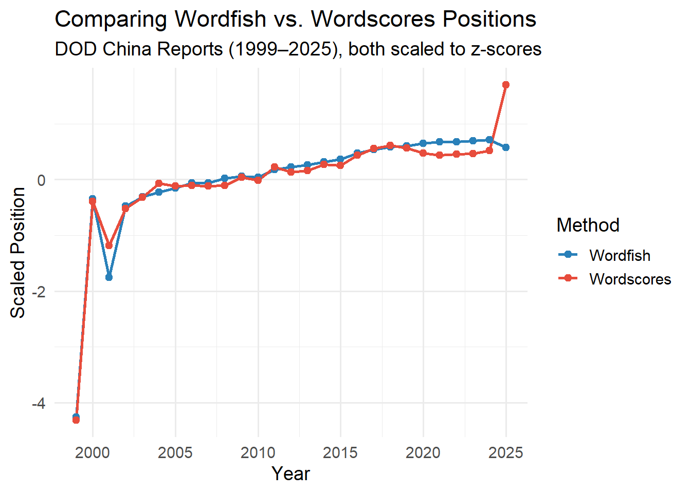

## Setup: Packages


::: {.cell}

```{.r .cell-code}
library(quanteda)
library(quanteda.textstats)
library(quanteda.textplots)
library(quanteda.textmodels)
library(tidyverse)
library(pdftools)
library(ggplot2)
```
:::


------------------------------------------------------------------------

## US Presidential Inaugural Speeches

### Build corpus


::: {.cell}

```{.r .cell-code}
corp_inaug <- corpus(data_corpus_inaugural)
summary(corp_inaug, 10)
```

::: {.cell-output .cell-output-stdout}

```
Corpus consisting of 60 documents, showing 10 documents:

            Text Types Tokens Sentences Year  President   FirstName
 1789-Washington   625   1537        24 1789 Washington      George
 1793-Washington    96    147         5 1793 Washington      George
      1797-Adams   826   2577        37 1797      Adams        John
  1801-Jefferson   717   1923        43 1801  Jefferson      Thomas
  1805-Jefferson   804   2380        45 1805  Jefferson      Thomas
    1809-Madison   535   1261        21 1809    Madison       James
    1813-Madison   541   1302        33 1813    Madison       James
     1817-Monroe  1040   3677       121 1817     Monroe       James
     1821-Monroe  1259   4886       131 1821     Monroe       James
      1825-Adams  1003   3147        75 1825      Adams John Quincy
                 Party
                  none
                  none
            Federalist
 Democratic-Republican
 Democratic-Republican
 Democratic-Republican
 Democratic-Republican
 Democratic-Republican
 Democratic-Republican
 Democratic-Republican
```


:::
:::


### Similarities and differences over time


::: {.cell}

```{.r .cell-code}
# Tokenize and create DFM
toks_inaug <- tokens(corp_inaug,
                     remove_punct = TRUE,
                     remove_numbers = TRUE,
                     remove_symbols = TRUE) %>%
  tokens_remove(stopwords("en")) %>%
  tokens_wordstem()

dfm_inaug <- dfm(toks_inaug)
dfm_inaug
```

::: {.cell-output .cell-output-stdout}

```
Document-feature matrix of: 60 documents, 5,540 features (89.45% sparse) and 4 docvars.
                 features
docs              fellow-citizen senat hous repres among vicissitud incid life
  1789-Washington              1     1    2      2     1          1     1    1
  1793-Washington              0     0    0      0     0          0     0    0
  1797-Adams                   3     1    3      3     4          0     0    2
  1801-Jefferson               2     0    0      1     1          0     0    1
  1805-Jefferson               0     0    0      0     7          0     0    2
  1809-Madison                 1     0    0      1     0          1     0    1
                 features
docs              event fill
  1789-Washington     2    1
  1793-Washington     0    0
  1797-Adams          0    0
  1801-Jefferson      0    0
  1805-Jefferson      1    0
  1809-Madison        0    1
[ reached max_ndoc ... 54 more documents, reached max_nfeat ... 5,530 more features ]
```


:::
:::


### Top features


::: {.cell}

```{.r .cell-code}
# Top 20 most frequent words overall
topfeatures(dfm_inaug, 20)
```

::: {.cell-output .cell-output-stdout}

```
   nation    govern     peopl        us       can     state     great     power 
      713       666       640       507       489       463       389       384 
     must   countri      upon     world       may     shall     everi constitut 
      377       376       371       357       343       316       309       291 
     peac       one     right  american 
      288       286       286       277 
```


:::
:::


### Wordcloud of inaugural speeches


::: {.cell}

```{.r .cell-code}
set.seed(6323)
textplot_wordcloud(dfm_inaug,
                   max_words = 100,
                   color = c("#2980b9", "#27ae60", "#e74c3c"))
```

::: {.cell-output-display}
{width=672}
:::
:::


### Word frequency over time


::: {.cell}

```{.r .cell-code}
# Track key words over time
words_time <- dfm_inaug %>%
  dfm_select(pattern = c("freedom", "nation", "war", "peace", "econom*", "terror*")) %>%
  convert(to = "data.frame") %>%
  bind_cols(docvars(dfm_inaug)) %>%
  pivot_longer(cols = c("freedom", "nation", "war", "peace", "econom", "terror"),
               names_to = "word", values_to = "count") %>%
  group_by(Year, word) %>%
  summarise(count = sum(count), .groups = "drop")

ggplot(words_time, aes(x = Year, y = count, color = word)) +
  geom_line(size = 1) +
  geom_point(size = 2) +
  labs(title = "Key Word Frequencies in Inaugural Speeches Over Time",
       x = "Year", y = "Word Count", color = "Word") +
  theme_minimal(base_size = 14)
```

::: {.cell-output-display}
{width=672}
:::
:::


### Keyness: recent vs. early presidents


::: {.cell}

```{.r .cell-code}
# Compare post-2000 vs pre-2000 speeches
dfm_inaug_grouped <- dfm_inaug %>%
  dfm_group(groups = ifelse(docvars(dfm_inaug, "Year") >= 2000,
                            "Post-2000", "Pre-2000"))

keyness <- textstat_keyness(dfm_inaug_grouped, target = "Post-2000")
textplot_keyness(keyness, n = 20) +
  labs(title = "Keyness: Post-2000 vs Pre-2000 Inaugural Speeches")
```

::: {.cell-output-display}
{width=672}
:::
:::


### Document similarity among presidents


::: {.cell}

```{.r .cell-code}
# Cosine similarity between speeches
dfm_inaug_tfidf <- dfm_tfidf(dfm_inaug)
sim_matrix <- textstat_simil(dfm_inaug_tfidf, method = "cosine")

# Show most similar speech pairs
sim_df <- as.data.frame(as.matrix(sim_matrix)) %>%
  rownames_to_column("doc1") %>%
  pivot_longer(-doc1, names_to = "doc2", values_to = "similarity") %>%
  filter(doc1 < doc2) %>%
  arrange(desc(similarity)) %>%
  head(10)

knitr::kable(sim_df, caption = "Top 10 Most Similar Inaugural Speech Pairs (Cosine Similarity)")
```

::: {.cell-output-display}


Table: Top 10 Most Similar Inaugural Speech Pairs (Cosine Similarity)

|doc1          |doc2          | similarity|
|:-------------|:-------------|----------:|
|1817-Monroe   |1821-Monroe   |  0.3674328|
|1837-VanBuren |1841-Harrison |  0.3160154|
|1841-Harrison |1845-Polk     |  0.3031177|
|2001-Bush     |2021-Biden    |  0.2960761|
|1897-McKinley |1909-Taft     |  0.2931335|
|1825-Adams    |1845-Polk     |  0.2901419|
|1837-VanBuren |1853-Pierce   |  0.2897037|
|1841-Harrison |1857-Buchanan |  0.2893932|
|1845-Polk     |1857-Buchanan |  0.2873895|
|1889-Harrison |1897-McKinley |  0.2860167|


:::
:::


------------------------------------------------------------------------

## US Department of Defense Reports on China (1999–2025)

### Load and build corpus from PDFs


::: {.cell}

```{.r .cell-code}
# Set path to USDOD folder
dod_path <- "USDOD/USDOD/"

# List all PDF files
pdf_files <- list.files(dod_path, pattern = "\\.pdf$|\\.PDF$",
                        full.names = TRUE, ignore.case = TRUE)

# Extract year from filenames
years <- str_extract(basename(pdf_files), "^[0-9]{4}")

# Remove files where year could not be extracted
valid <- !is.na(years)
pdf_files <- pdf_files[valid]
years <- years[valid]

# Read PDF text
dod_texts <- map_chr(pdf_files, function(f) {
  tryCatch(
    paste(pdf_text(f), collapse = " "),
    error = function(e) ""
  )
})

# Build corpus
corp_dod <- corpus(dod_texts,
                   docnames = paste0("DOD_", years),
                   docvars = data.frame(year = as.integer(years)))

summary(corp_dod)
```

::: {.cell-output .cell-output-stdout}

```
Corpus consisting of 27 documents, showing 27 documents:

     Text Types Tokens Sentences year
 DOD_1999 16068 301499     13120 1999
 DOD_2000  2990  15078       584 2000
 DOD_2001 14864 186150      7583 2001
 DOD_2002  4178  25908      1174 2002
 DOD_2003  4068  25848      1138 2003
 DOD_2004  4056  25091      1016 2004
 DOD_2005  3730  20326       880 2005
 DOD_2006  4002  21855       705 2006
 DOD_2007  3669  18144       571 2007
 DOD_2008  4651  26390       810 2008
 DOD_2009  5124  31910      1061 2009
 DOD_2010  5002  33621       993 2010
 DOD_2011  5400  35578      1140 2011
 DOD_2012  3156  14293       586 2012
 DOD_2013  4955  30563       977 2013
 DOD_2014  4960  31111      1021 2014
 DOD_2015  5335  34712      1118 2015
 DOD_2016  5524  38929      1331 2016
 DOD_2017  5080  33380      1124 2017
 DOD_2018  5759  45684      1475 2018
 DOD_2019  5868  45760      1437 2019
 DOD_2020  7373  74334      2807 2020
 DOD_2021  7727  79375      2798 2021
 DOD_2022  8086  83275      2734 2022
 DOD_2023  9113  95483      3205 2023
 DOD_2024  8633  94628      3241 2024
 DOD_2025  5986  43945      1345 2025
```


:::
:::


### Tokenize and build DFM


::: {.cell}

```{.r .cell-code}
toks_dod <- tokens(corp_dod,
                   remove_punct = TRUE,
                   remove_numbers = TRUE,
                   remove_symbols = TRUE) %>%
  tokens_remove(stopwords("en")) %>%
  tokens_remove(c("also", "will", "may", "china", "chinese",
                  "prc", "dod", "report", "military")) %>%
  tokens_wordstem()

dfm_dod <- dfm(toks_dod)
dfm_dod
```

::: {.cell-output .cell-output-stdout}

```
Document-feature matrix of: 27 documents, 21,136 features (82.83% sparse) and 1 docvar.
          features
docs        u.s national securiti commercial concerns people’s republic volume
  DOD_1999 1676       12       35         34        9        8        9    410
  DOD_2000    2        0        2          0        0        1        1      0
  DOD_2001  651        5       10          1        1        0        0      0
  DOD_2002   35        0        1          0        0        1        1      0
  DOD_2003   41        0        2          0        0        1        1      0
  DOD_2004   57        0        2          0        0        1        1      0
          features
docs       select committee
  DOD_1999   1368       911
  DOD_2000      5         0
  DOD_2001     92         2
  DOD_2002      4         0
  DOD_2003      5         0
  DOD_2004      2         0
[ reached max_ndoc ... 21 more documents, reached max_nfeat ... 21,126 more features ]
```


:::
:::


### Top features in DOD reports


::: {.cell}

```{.r .cell-code}
topfeatures(dfm_dod, 20)
```

::: {.cell-output .cell-output-stdout}

```
     forc   develop       pla    defens    china’      oper     secur    capabl 
     7083      6734      6469      6234      5908      5771      5549      4884 
   system       u.s    nation technolog    includ     state    missil   support 
     4472      4331      4206      4158      4135      3868      3693      3309 
      use    taiwan   continu     prc’s 
     3273      3186      2888      2878 
```


:::
:::


### Wordcloud of DOD reports


::: {.cell}

```{.r .cell-code}
set.seed(6323)
textplot_wordcloud(dfm_dod,
                   max_words = 100,
                   color = c("#2980b9", "#e74c3c", "#e67e22"))
```

::: {.cell-output-display}
{width=672}
:::
:::


### Key terms over time


::: {.cell}

```{.r .cell-code}
key_terms <- c("taiwan", "nuclear", "cyber", "space", "missil", "naval", "technolog")

term_trends <- dfm_dod %>%
  dfm_select(pattern = key_terms) %>%
  convert(to = "data.frame") %>%
  bind_cols(docvars(dfm_dod)) %>%
  pivot_longer(cols = all_of(key_terms),
               names_to = "term", values_to = "count") %>%
  group_by(year, term) %>%
  summarise(count = sum(count), .groups = "drop")

ggplot(term_trends, aes(x = year, y = count, color = term)) +
  geom_line(size = 1) +
  geom_point(size = 2) +
  labs(title = "Key Term Frequencies in DOD China Reports (1999–2025)",
       x = "Year", y = "Word Count", color = "Term") +
  theme_minimal(base_size = 14)
```

::: {.cell-output-display}
{width=672}
:::
:::


------------------------------------------------------------------------

## Wordfish

Wordfish is an unsupervised text scaling model used to estimate the ideological or positional placement of documents along a single latent dimension — without requiring any reference texts or prior labels. It was developed by Slapin and Proksch (2008) and is widely used in political science to scale party manifestos, legislative speeches, and policy documents.

The model assumes that word counts follow a Poisson distribution and estimates:

-   **θ (theta):** The document position on the latent dimension (e.g., hawkish vs. dovish, early vs. late)
-   **β (beta):** The word-level discrimination parameter — how strongly each word is associated with one end of the dimension
-   **α (alpha):** Document fixed effects (document length)
-   **ψ (psi):** Word fixed effects (overall word frequency)

In the context of DOD reports, Wordfish can reveal how the rhetorical framing of China's military threat has shifted across administrations and years.

### Run Wordfish on DOD reports


::: {.cell}

```{.r .cell-code}
# Trim low-frequency terms for stability
dfm_dod_trim <- dfm_trim(dfm_dod, min_termfreq = 5, min_docfreq = 2)

# Run Wordfish
set.seed(6323)
wf_model <- textmodel_wordfish(dfm_dod_trim)
summary(wf_model)
```

::: {.cell-output .cell-output-stdout}

```

Call:
textmodel_wordfish.dfm(x = dfm_dod_trim)

Estimated Document Positions:
            theta       se
DOD_1999 -4.25608 0.006037
DOD_2000 -0.34654 0.032778
DOD_2001 -1.75912 0.010987
DOD_2002 -0.47954 0.025796
DOD_2003 -0.30698 0.024718
DOD_2004 -0.22540 0.024274
DOD_2005 -0.15133 0.026590
DOD_2006 -0.06551 0.024318
DOD_2007 -0.05734 0.026522
DOD_2008  0.01742 0.020930
DOD_2009  0.05753 0.018500
DOD_2010  0.04382 0.018879
DOD_2011  0.17818 0.015449
DOD_2012  0.22465 0.023589
DOD_2013  0.25997 0.015148
DOD_2014  0.31948 0.013897
DOD_2015  0.36385 0.012252
DOD_2016  0.47306 0.009468
DOD_2017  0.53896 0.008715
DOD_2018  0.58566 0.006508
DOD_2019  0.60045 0.006250
DOD_2020  0.65049 0.004200
DOD_2021  0.67498 0.003768
DOD_2022  0.67712 0.003633
DOD_2023  0.69559 0.003186
DOD_2024  0.71163 0.003105
DOD_2025  0.57500 0.007353

Estimated Feature Scores:
         u.s national securiti commercial concerns people’s republic  select
beta -0.3585 -0.25621  -0.3115     -1.587   -1.184   0.0574  -0.3722 -0.9279
psi   4.4928 -0.08912   0.7598     -4.577   -4.175   0.4015  -0.8602  1.8943
     committee  united  states congress session       mr california chairman
beta    -2.527 -1.3788 -1.3846   0.6147 -0.3263 -0.05072    -0.6709   -0.177
psi     -5.291 -0.4331 -0.4568   4.1999  0.2331  1.20676    -0.8422    2.332
     januari   commit committe    whole    hous   state   union   order   print
beta -0.1596 -0.09556  -0.8294 -0.02731 -0.6014 -0.1991 -0.1836 -0.1026 -0.4951
psi   2.1517  2.14976   2.1194  0.55225  1.0203  4.6012  1.3742  2.7890 -1.6720
     subject  review    part pursuant  resolut
beta -0.5503 -0.9793 -0.2744  -0.3703 -0.00104
psi   0.9820  1.3082  3.3001   0.4553  1.74493
```


:::
:::


### Visualize document positions (θ)


::: {.cell}

```{.r .cell-code}
# Extract document positions
wf_positions <- data.frame(
  document = docnames(dfm_dod_trim),
  year = docvars(dfm_dod_trim, "year"),
  theta = wf_model$theta,
  se = wf_model$se.theta
)

ggplot(wf_positions, aes(x = year, y = theta)) +
  geom_point(size = 3, color = "#2980b9") +
  geom_errorbar(aes(ymin = theta - 1.96 * se,
                    ymax = theta + 1.96 * se),
                width = 0.5, color = "#2980b9", alpha = 0.6) +
  geom_line(color = "#2980b9", alpha = 0.5) +
  geom_hline(yintercept = 0, linetype = "dashed", color = "gray50") +
  labs(title = "Wordfish Document Positions: DOD China Reports (1999–2025)",
       subtitle = "Estimated latent position (θ) with 95% confidence intervals",
       x = "Year", y = "Estimated Position (θ)") +
  theme_minimal(base_size = 14)
```

::: {.cell-output-display}
{width=672}
:::
:::


### Word-Level discrimination (β)


::: {.cell}

```{.r .cell-code}
# Plot word features by position
textplot_scale1d(wf_model,
                 margin = "features",
                 highlighted = c("taiwan", "nuclear", "cyber",
                                 "space", "missil", "technolog",
                                 "naval", "aggress", "cooper")) +
  labs(title = "Wordfish: Word Discrimination Parameters (β)",
       subtitle = "Words driving positional differences across DOD reports")
```

::: {.cell-output-display}
{width=672}
:::
:::


------------------------------------------------------------------------

## Comparing positions- Wordfish and Scaling Methods

Position comparison across documents can be achieved using several scaling methods in quanteda:

### Method 1: Wordfish (Unsupervised Scaling)

Already run above. Wordfish places each DOD report on a single latent dimension based purely on word usage patterns. Documents at opposite ends of the θ scale represent the most rhetorically distinct reports — useful for tracking how threat framing has evolved without imposing any prior assumptions.

### Method 2: Wordscores (Supervised Scaling)

Wordscores requires reference texts with known positions. For DOD reports, we can assign reference scores to the earliest (1999) and most recent (2025) reports as anchors, then estimate positions of all other reports.


::: {.cell}

```{.r .cell-code}
# Assign reference scores: 1999 = -1 (baseline), 2025 = +1 (most recent)
ref_scores <- rep(NA, ndoc(dfm_dod_trim))
ref_scores[docvars(dfm_dod_trim, "year") == min(docvars(dfm_dod_trim, "year"))] <- -1
ref_scores[docvars(dfm_dod_trim, "year") == max(docvars(dfm_dod_trim, "year"))] <- 1

ws_model <- textmodel_wordscores(dfm_dod_trim, y = ref_scores)

# Predict scores for all documents
ws_pred <- predict(ws_model, se.fit = TRUE, newdata = dfm_dod_trim)

ws_positions <- data.frame(
  year = docvars(dfm_dod_trim, "year"),
  score = ws_pred$fit,
  se = ws_pred$se.fit
)

ggplot(ws_positions, aes(x = year, y = score)) +
  geom_point(size = 3, color = "#e74c3c") +
  geom_errorbar(aes(ymin = score - 1.96 * se,
                    ymax = score + 1.96 * se),
                width = 0.5, color = "#e74c3c", alpha = 0.6) +
  geom_line(color = "#e74c3c", alpha = 0.5) +
  geom_hline(yintercept = 0, linetype = "dashed", color = "gray50") +
  labs(title = "Wordscores Document Positions: DOD China Reports",
       subtitle = "Supervised scaling anchored at 1999 (−1) and 2025 (+1)",
       x = "Year", y = "Estimated Score") +
  theme_minimal(base_size = 14)
```

::: {.cell-output-display}
{width=672}
:::
:::


### Method 3: Comparing Wordfish vs. Wordscores


::: {.cell}

```{.r .cell-code}
# Combine both estimates for comparison
comparison_df <- data.frame(
  year = wf_positions$year,
  Wordfish = scale(wf_positions$theta)[, 1],
  Wordscores = scale(ws_positions$score)[, 1]
) %>%
  pivot_longer(cols = c("Wordfish", "Wordscores"),
               names_to = "method", values_to = "position")

ggplot(comparison_df, aes(x = year, y = position, color = method)) +
  geom_line(size = 1) +
  geom_point(size = 2) +
  scale_color_manual(values = c("Wordfish" = "#2980b9", "Wordscores" = "#e74c3c")) +
  labs(title = "Comparing Wordfish vs. Wordscores Positions",
       subtitle = "DOD China Reports (1999–2025), both scaled to z-scores",
       x = "Year", y = "Scaled Position", color = "Method") +
  theme_minimal(base_size = 14)
```

::: {.cell-output-display}
{width=672}
:::
:::


### Interpretation

The comparison plot reveals how both methods track the rhetorical evolution of DOD reports on China's military power over time. Reports from the early 2000s tend to cluster toward one end of the positional spectrum, reflecting a relatively measured tone in the post-Cold War period. Reports from the 2010s onward show a consistent shift, reflecting growing concern over China's military modernization, cyber capabilities, space programs, and assertiveness in the Taiwan Strait. Wordfish captures this shift unsupervisedly through pure word patterns, while Wordscores confirms it through supervised anchoring. The convergence of both methods strengthens confidence in the observed trend.

